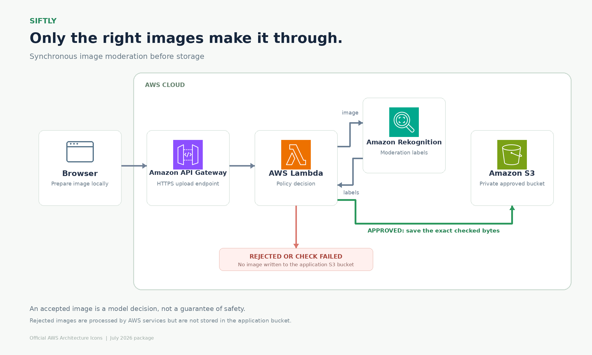
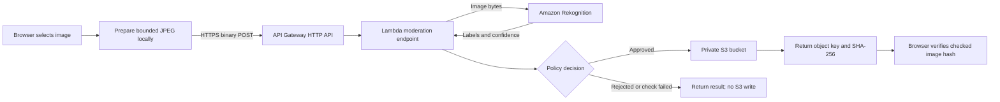

# Siftly architecture and policy

## Default policy

The current configurable defaults reject Rekognition labels at or above 70% confidence matching these names or an immediate child:

- `Explicit`
- `Non-Explicit Nudity of Intimate parts and Kissing`
- `Swimwear or Underwear`
- `Violence`, including weapons
- `Visually Disturbing`

These are strict example choices, not a recommended universal policy. In particular they can reject swimwear, kissing, and images containing weapons. Categories such as alcohol, drugs and tobacco, gambling, rude gestures, and hate symbols are **not blocked by the defaults**; configure them explicitly if required. AWS's label taxonomy is documented at https://docs.aws.amazon.com/rekognition/latest/dg/moderation-api.html. The threshold is the model's confidence in a label, not a probability that an image is safe.

Set `blocked_categories` (comma-separated exact label names) and `moderation_confidence` (0–100) as Terraform variables. Evaluate and choose them with a labeled representative dataset before real use. The comparison checks a label and its immediate parent; the service can return top-level labels with matching children. The application is not a comprehensive safety or illegality detector.

## Storage boundary

Lambda sends the same in-memory bytes to Rekognition and then to S3 only after policy approval. Denied images and moderation errors do not trigger a write to the application bucket. API Gateway, Lambda and Rekognition process the image; this is not a guarantee about AWS service-level retention. Logs must not include image payloads.
